<div align="center">

# LumaLi

**A lightweight, deeply customizable open-source app for the Lian Li Universal Screen 8.8", TL Wireless LCD fans and wireless fan lighting.**

30+ animated live-sensor layouts · a drag-and-drop layout editor · 22 fan-screen faces · Lottie animations · lighting that reacts to your temperatures · fan curves.
One small `.exe`, no installer, no account, no telemetry.

[](LICENSE)


[](https://github.com/sponsors/Najibra)

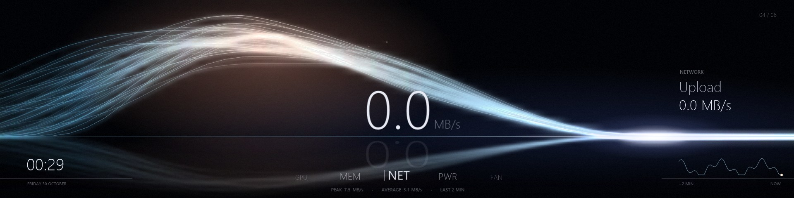

</div>

> LumaLi is an independent community project. It is not made, endorsed or supported by Lian Li.
> Close L-Connect before running it: two programs cannot drive the same USB devices at once.

## Why LumaLi

**Light on your system.** Measured on a Ryzen 7 9800X3D (16 threads), with the heaviest setup running at once — the animated Lightbeam layout on the 8.8" screen at 20 fps, five animated fan screens at 12 fps and the light strip synced to the screen at 30 fps:

| | LumaLi |
|---|---|
| CPU, whole app, heaviest setup | about 0.7 of one core (≈ 4 % of the whole CPU) |
| Memory | about 190 MB |
| Download | one 5.7 MB `.exe` (needs the free .NET 8 Desktop Runtime) |
| Background services, drivers, installers | none |
| Network access, accounts, telemetry | none — it never goes online |

Most layouts draw a frame in 1–6 ms, and layouts without animation only redraw when a reading changes. Fan lighting effects are uploaded to the fans once and then run on the fans themselves, at no CPU cost. Each screen and fan runs on its own thread, so editing one never stalls the others. You can measure it yourself with `LumaLi.exe --bench`.

**Built to be customized.**

- **A real layout editor** for the 1920×480 screen: drag, resize, snap, align, undo/redo, copy and paste. Widgets include text with live readings (`{cpu.load:0}%`, `{time:HH:mm}`, …), values, gauges, rings, bars, graphs, per-thread CPU bars, glass panels, images, GIFs and Lottie animations (`.json` / `.lottie`). A Lottie can loop, or follow a reading so it scrubs with your CPU or GPU load.
- **Backgrounds:** solid, gradient, aurora, neon grid, heat waves, tunnel, carved stone, your own image or GIF, or a video.
- **30+ built-in templates** to start from. Built-ins are copied on your first change, so the originals are never lost; remove the ones you don't use and restore them any time.
- **Export and import layouts** as `.json` to share them.
- **22 fan-screen faces**, each with its own sensor, label, two colours, rotation and optional background image or GIF. The **Lottie Gauge** face has four built-in gauge styles (Arc, Needle, Liquid, LED ring) or takes your own Lottie, and can switch to a breathing warning colour above a level you set.
- **Lighting:** 21 animated fan effects (including Aurora and Comet trail) with their own speed, brightness and colours, and a light strip that can **match the screen layout** — the strip takes its colours and movement from whatever the screen is showing.
- **Reactive lighting:** the fans can follow a reading, such as GPU temperature, and warm from your colours toward amber and red in four gentle steps as it rises.
- **Standby screen:** a calm face with your logo (or the LumaLi mark), a large clock and the date, shown when the PC is idle or locked and left on the screen as it sleeps, hibernates or shuts down (if your motherboard keeps USB powered).
- **New in 1.2:** vertical layouts for a screen stood on its end (four templates and a new Silk background), per-game layouts that switch in while a chosen game runs, a game frame-rate sensor, video files and shuffled playlists on the fan screens, and fan order you can set to match how your fans are mounted.
- **Cooling:** presets, an automatic curve that follows GPU or CPU temperature (with a fail-safe to 100 % if the sensor stops), per-group trim and fan calibration.

## Screenshots

### Screen layouts (8.8", 1920 × 480)

| | |
|---|---|
| 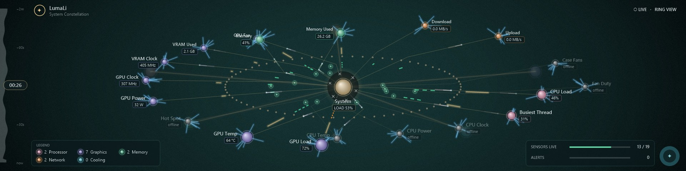 **Constellation** — every sensor as an orb on a ring that folds into a network | 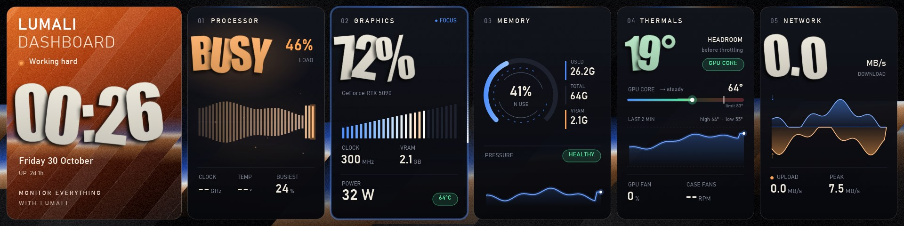 **Spectrum Deck** — live instrument cards that heat up under load |
| 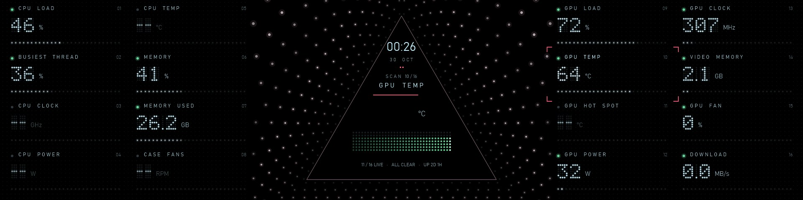 **Void** — a 16-channel LED control room around a dot tunnel | 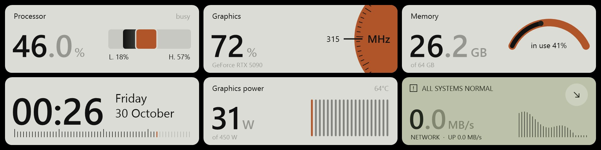 **Instrument** — calm grey gauge tiles |
| 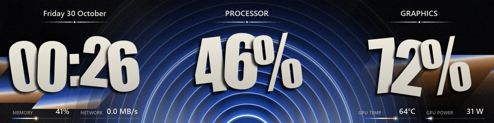 **Spectrum** — swaying slab type over a sonar dome | 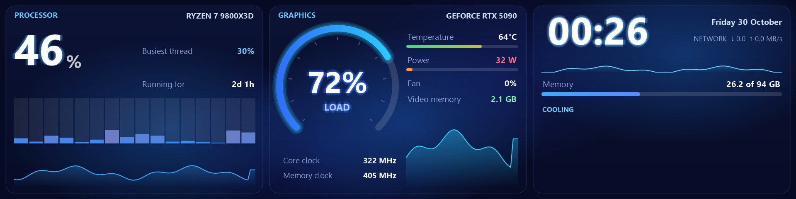 **Command Center** — the classic three-panel dashboard |
| 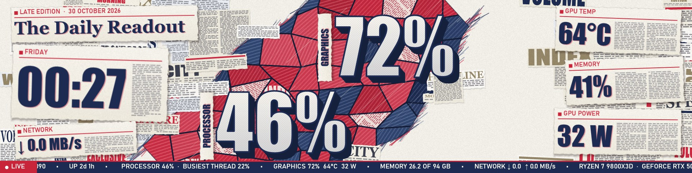 **Headline** — newsprint collage with a press roller | 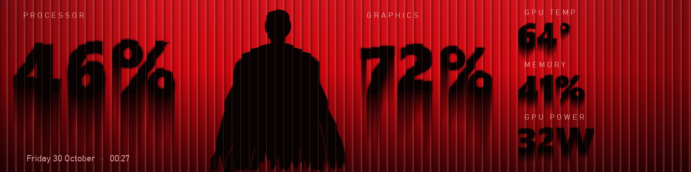 **Reeded** — readings behind reeded glass |
| 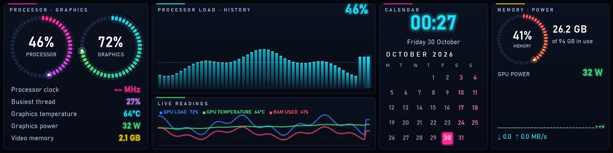 **Neon** — neon rings, charts and a calendar | 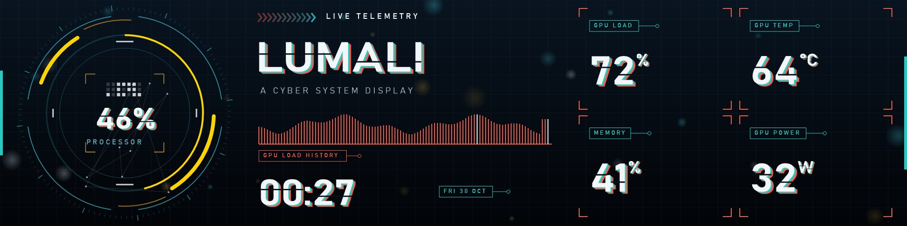 **Astro** — a cyber HUD |
| 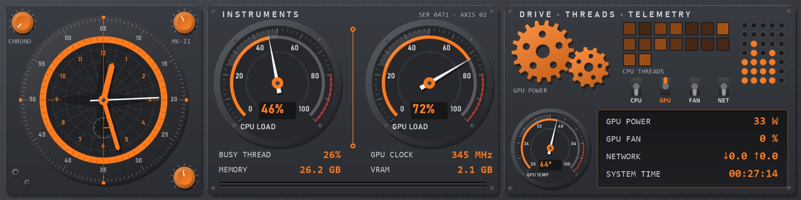 **Mechanica** — machined gauges and gears | 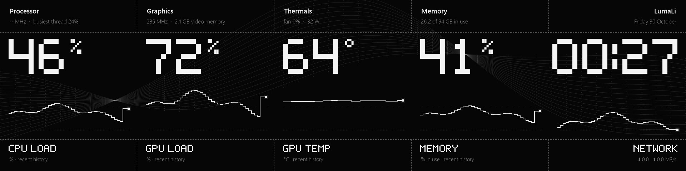 **Pixotype** — a pixel-type specimen sheet |
| 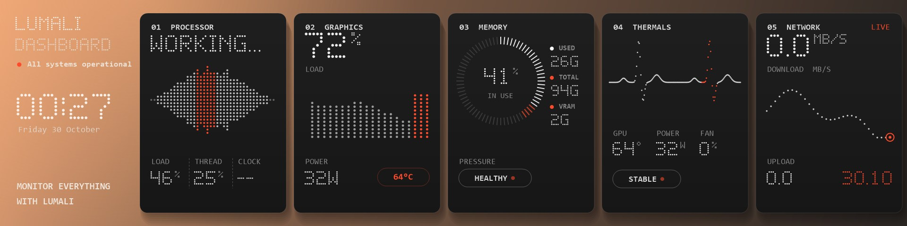 **Deer** — a dotted LED dashboard | 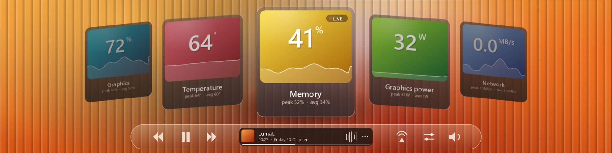 **Carousel** — a turning carousel of glass cards |
|  **Right Now** — poster numbers that stamp on every change | 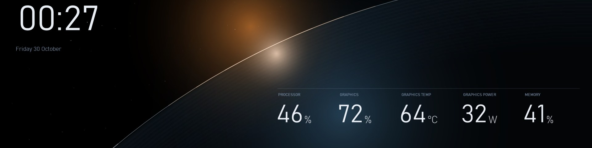 **Eclipse** — sunrise over a planet's edge |

…plus Lightbeam (top of this page), Paper Cut, Lighthouse, Pixel, Prism, Stretch, Gap, Blade, Vinyl, Balloon, Classic, Neon Grid, Heat Wave, Glass Tunnel, Carved, Minimal Clock and Focus GPU. Every layout is animated live from your sensors.

### Fan screens (400 × 400)

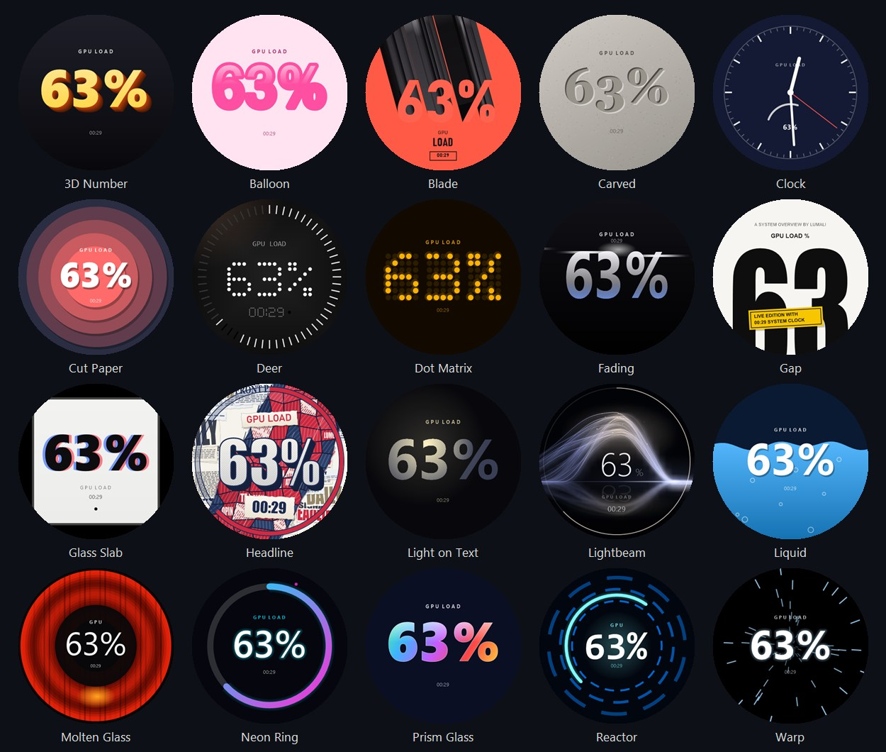

### The app

| | |
|---|---|
| 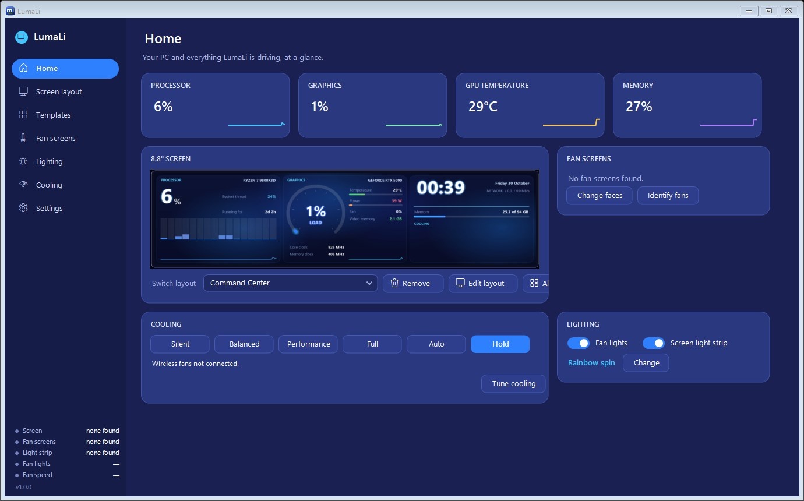 **Home** | 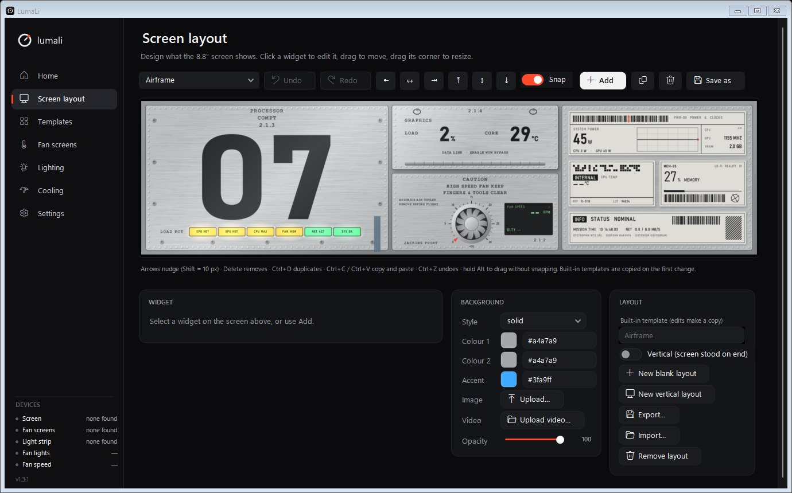 **Screen layout editor** |
| 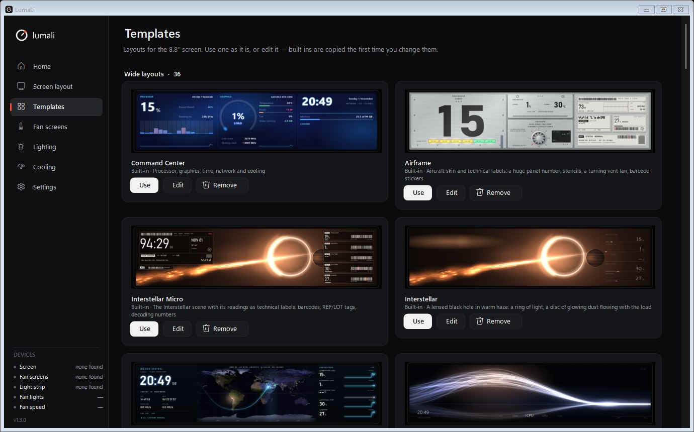 **Templates** | 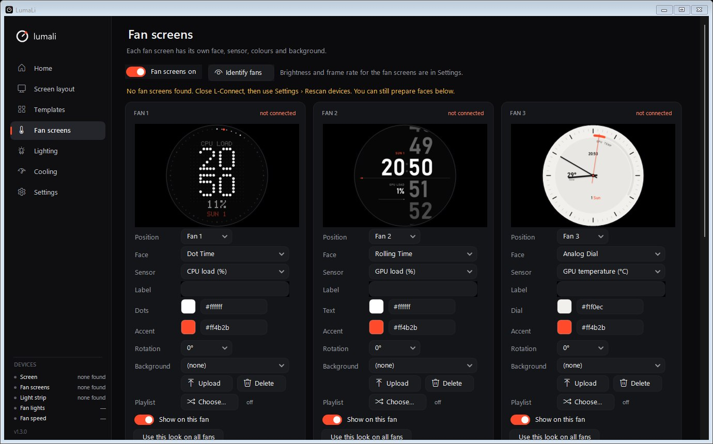 **Fan screens** |
| 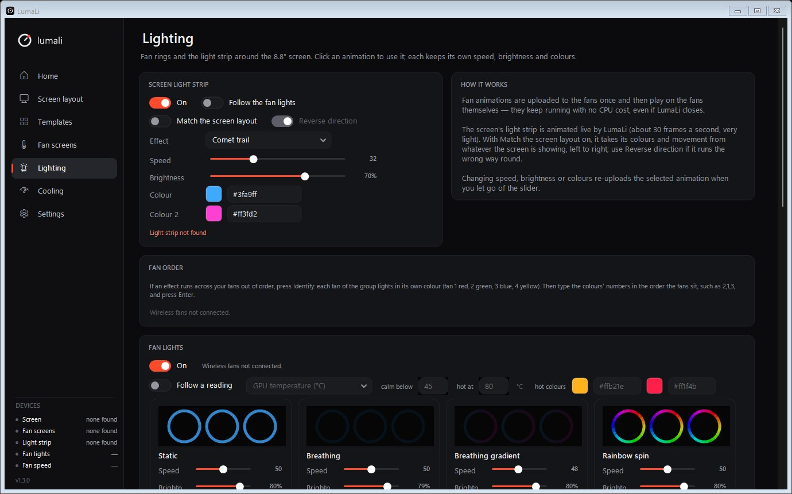 **Lighting** | 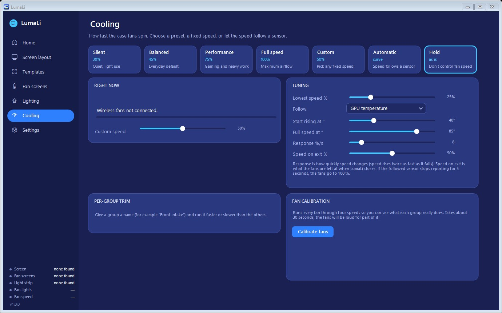 **Cooling** |

## Supported hardware

LumaLi talks to specific devices over USB. It does **not** support every Lian Li product.

| Device | USB ID | Status |
|---|---|---|
| Universal Screen 8.8" | `1CBE:A088` | ✅ Supported and tested |
| Light strip around the 8.8" screen | `0416:8050` | ✅ Supported and tested |
| UNI FAN TL Wireless LCD — fan screens | `1CBE:0006` | ✅ Supported and tested (five fans) |
| Wireless controller/dongle — fan lighting and speed | `0416:8040` / `0416:8041` | ✅ Tested with TL Wireless fans · ⚠️ SL Wireless, SL-INF and CL wireless groups are recognised but untested |
| TL Flex LCD / SL Infinity Flex LCD — fan screens | `1CBE:A018` / `1CBE:A019` | 🧪 Experimental (1.2), untested — reports welcome |
| Wired TL LCD fans — fan screens | `04FC:7393` | 🧪 Experimental (1.2), untested — reports welcome |
| Wired UNI HUB controllers, Galahad / HydroShift LCD coolers, Strimer, O11 Vision and other screens | — | ❌ Not supported |

If you own a device marked untested or not supported and would like to help, please open an issue and paste the report from **Settings → Devices → Copy device report**.

## Getting started

1. Install the [.NET 8 Desktop Runtime](https://dotnet.microsoft.com/download/dotnet/8.0) (x64) if you don't have it.
2. Download `LumaLi.exe` from [Releases](../../releases).
3. Close L-Connect (and turn off its start-with-Windows option).
4. Run `LumaLi.exe`. On first launch your current fan lighting and fan speeds are left as they are until you change them.

Settings, layouts and uploads are kept in `%APPDATA%\LumaLi`. CPU temperature needs LumaLi to run as administrator (Settings → Restart as administrator); everything else works without it.

## Building from source

```
dotnet publish LumaLi.csproj -c Release -r win-x64 --self-contained false -p:PublishSingleFile=true -p:IncludeNativeLibrariesForSelfExtract=true -o dist
```

This gives a single `dist\LumaLi.exe`. `LumaLi.exe --test <folder>` runs 151 offline checks (protocol framing, every face, template and effect) and writes renders of each; `--render-layout <Name> <folder>` saves stills of any layout. Neither touches your devices.

## How it works

LumaLi is a .NET 8 WinForms app. Screens are drawn with GDI+ and [SkiaSharp](https://github.com/mono/SkiaSharp) (glow, blur and Lottie through Skottie) and sent as JPEG frames at up to 30 fps; sensors come from [LibreHardwareMonitor](https://github.com/LibreHardwareMonitor/LibreHardwareMonitor). The USB protocols are documented in [docs/PROTOCOL.md](docs/PROTOCOL.md).

## Support LumaLi

LumaLi is free and always will be. If it brightens up your build, you can support its development through [GitHub Sponsors](https://github.com/sponsors/Najibra) — every bit helps keep new layouts and devices coming. Stars, bug reports and shared screenshots help too.

## Credits

- Protocol research: [sgtaziz/lian-li-linux](https://github.com/sgtaziz/lian-li-linux) (MIT)
- Compression for fan lighting: [sisong/tinyuz](https://github.com/sisong/tinyuz) (MIT)
- Drawing and Lottie: [SkiaSharp and SkiaSharp.Skottie](https://github.com/mono/SkiaSharp) (MIT)
- Sensors: [LibreHardwareMonitorLib](https://github.com/LibreHardwareMonitor/LibreHardwareMonitor) (MPL-2.0)

See [THIRD-PARTY-NOTICES.md](THIRD-PARTY-NOTICES.md).

## Licence and disclaimer

LumaLi is released under the [MIT licence](LICENSE).

Lian Li, UNI FAN, L-Connect and related names are trademarks of their respective owners and are used here only to describe compatibility. LumaLi controls fan speeds and lighting directly; use it at your own risk.
