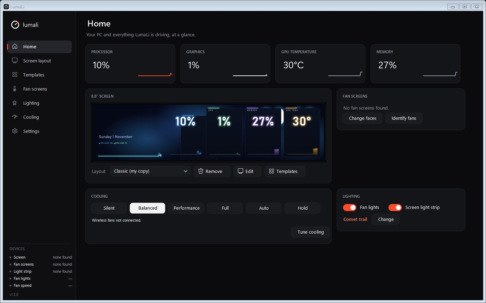
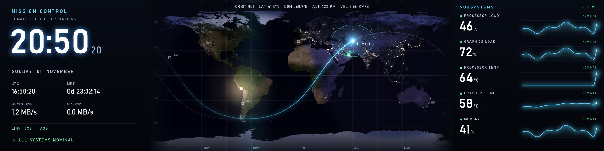
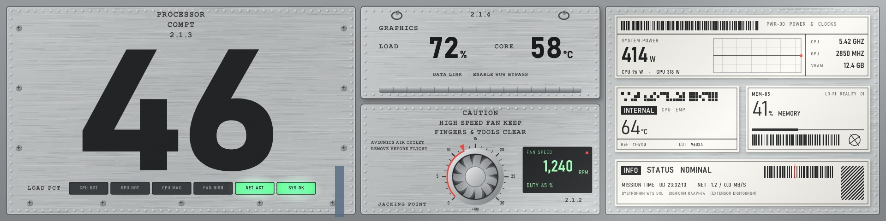
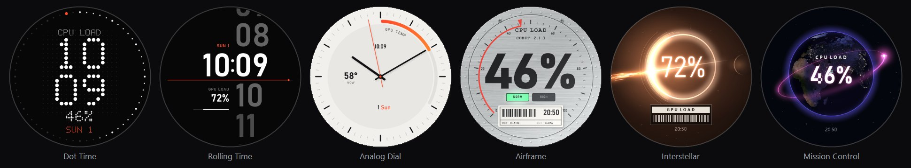

# LumaLi 1.3.0

A new look, new layouts and new fan faces. This is the first public release since 1.0.0, so it also includes
everything from 1.1 and 1.2 (summarised at the end).

## A new look

- **Redesigned app.** A calm, near-black interface with white text and one red-orange accent, flat cards, clearer
  buttons (the main action on each card is the white one), a quieter sidebar with device status at the foot, and dark
  scrollbars.
- **New logo and icon.** A ring with a single hand pointing at a red dot: a dial, a gauge and a fan in one.
- **Startup screen.** The logo draws itself while LumaLi opens its sensors and devices, then fades away. It stays
  hidden when LumaLi starts in the tray.

## New screen layouts

- **Mission Control.** A flight-operations wall: a NASA Earth map with the live day/night line, a spacecraft on its
  ground track with links to ground stations, a mission clock, and five live subsystem traces.
- **Interstellar.** A lensed black hole in warm haze, inspired by the film's mood: a ring of light, a disc of glowing
  dust that flows faster as the CPU works, a planet that eclipses it, and thin animated type with a "time dilation"
  caption.
- **Interstellar Micro.** The same scene with its readings as technical labels: barcodes swept by a red laser,
  REF/LOT tags and numbers that decode as they change.
- **Airframe.** An aircraft skin: brushed plates, rivets and stencils, the CPU load as a huge panel number on rolling
  counter wheels, a vent fan that turns at your real fan speed inside a tachometer with the exact RPM, a power and
  clocks sticker with a 30-second strip chart, and cockpit warning lamps.
- **Five more vertical layouts:** Right Now Tower, Instrument Column, Deck Tower, Stretch Tower and Gap Tower.
- **Classic, Neon Grid, Heat Wave, Minimal Clock and Focus GPU** redrawn with real glow.

## New fan faces

- **Dot Time:** the time in dot-matrix figures that melt from one minute to the next, a ring of dots that fills with
  the reading, and a red dot that walks round with the seconds.
- **Rolling Time:** the minutes roll up in a column as each minute turns, and a red line grows across with the seconds.
- **Analog Dial:** a light watch dial with a smooth red second hand and the reading as a red-to-orange arc.
- **Airframe**, **Interstellar** and **Mission Control** (a turning globe with a satellite) to match the layouts.
- Fan faces now show your background picture, GIF or video behind them.

## Smart features (Settings → Smart)

- **Auto mode:** a layout and a fan effect for gaming, watching and working, picked by what you are doing (game
  profiles still come first).
- **Monitor colours:** the light strip and fans can follow the colours on your monitor.
- **Health watch:** learns your normal temperatures and fan speeds over two weeks, then tells you if the PC starts
  running warmer or a fan group slows down (dust, a failing fan).
- **Busiest app:** `{top.app}` shows which program is using the most CPU.

## Fixed

- Template previews of some layouts were shifted and cut off on displays scaled above 100 %.
- Mission Control could freeze on the screen.
- The game frame-rate sensor no longer picks up terminals and code editors.

## From 1.1 and 1.2

- **Lottie animations** wherever GIFs work, including a gauge face and images that follow a reading.
- **Reactive fan lighting** that warms toward amber and red as a temperature rises; **Aurora** and **Comet trail**
  effects.
- **Standby screen** with a large clock while the PC is idle, locked or asleep.
- The 8.8" screen runs at up to **30 fps**.
- **Vertical layouts** for a screen stood on its end, and the **Silk** background.
- **Per-game layouts**, a **game frame-rate** sensor, **fan order** controls, **videos and playlists** on fan screens,
  and **Copy device report** for bug reports.
- Experimental support for **TL Flex LCD**, **SL Infinity Flex LCD** and **wired TL LCD** fans (untested, reports
  welcome).

Needs the .NET 8 Desktop Runtime (x64). Close L-Connect before running LumaLi.
