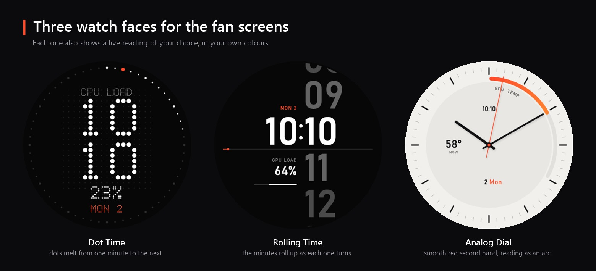

# LumaLi 1.3.1

Answers to the remaining requests from the Reddit thread. For everything new in 1.3, see
[RELEASE-NOTES-1.3.0.md](RELEASE-NOTES-1.3.0.md).

## New

- **Lancool 207 Digital front screen (experimental).** LumaLi now recognises the case's 720 × 1472 screen
  (USB 1CBE:A065) and, when no 8.8" screen is connected, shows your layouts on it. Every layout is fitted whole, wide
  or vertical, over a soft, dimmed copy of itself instead of black bars. Settings › 8.8" screen › Flip turns it 180°.
  Built from the protocol documented by lian-li-linux; untested here, so reports are very welcome.
- **Start as administrator when you sign in.** Settings › App › "…as administrator". Windows only gives the CPU
  temperature (and the game frame rate) to programs running as administrator; this starts LumaLi that way at every
  sign-in, without a prompt, through a Task Scheduler task. Turn it on once from an elevated LumaLi
  (Settings › Restart as administrator).
- **CPU temperature note on Home.** If the CPU temperature hasn't appeared after a few seconds, Home says why and
  offers the fix: restart as administrator, or, on Ryzen 9000 and some other new processors, install the free
  PawnIO driver. It can be hidden.
- **Device report** (Settings › Devices › Copy device report) now also lists CH340 (1A86) devices and anything named
  Turzx, which is what adding Turzx screens needs. If you own one, please send a report.

## Fixed

- The Smart card's description on the Settings page was cut off mid-sentence.

## Also

- The three watch faces (Dot Time, Rolling Time, Analog Dial) now have their own picture in the README.

Needs the .NET 8 Desktop Runtime (x64). Close L-Connect before running LumaLi.
